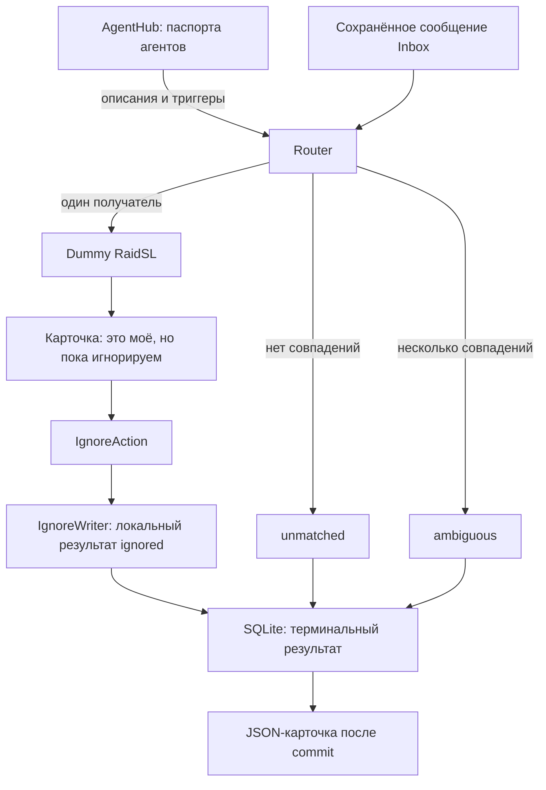

# Registry агентов и dummy RaidSL

Реализован первый срез **AgentHub → Router → Agent → Action → Writer**.
Все компоненты работают в одном процессе. Внешних вызовов, LLM, MCP и отправки
сообщений здесь нет. Human-in-the-loop не является обязательной частью общего
механизма; конкретный агент сможет определить его в своей реализации.

## Границы



- **AgentHub** явно регистрирует экземпляры агентов. Passport содержит стабильный
  `agent_id`, описание интереса, триггер-фразы и необязательные исключения. Повторный
  ID и пустые триггеры отклоняются. Порядок регистрации не определяет победителя.
- **Router** сопоставляет сообщение с паспортами. Это один проход по дешёвым
  правилам, а не вызов каждого агента для анализа. Ровно одно совпадение даёт
  `matched`, ни одного — `unmatched`, несколько — `ambiguous`. При двух последних
  результатах ни один агент не вызывается.
- **Agent** получает нормализованное `IncomingMessage` без Telethon-клиента и
  credentials. Игровая логика, разрешение имён персонажей, выбор картинок и будущий
  human-in-the-loop принадлежат агенту, а не Router.
- **Action** сейчас имеет единственный вариант `IgnoreAction`. Карточка является
  структурированным результатом агента с заголовком и пояснением.
- **IgnoreWriter** локально исполняет только `ignore` и возвращает `ignored`.
  Неизвестный тип действия отклоняется. Telegram Writer и отправка не реализованы.

`packages/agents` не зависит от Telegram и SQLite. `apps/telegram-agent/src/aenea_telegram/routing.py`
собирает registry с одним `RaidSLAgent` и связывает Dispatcher с Inbox и CLI.
Отдельного процесса оркестратора или сетевого AgentHub нет.

## Dummy RaidSL

ID — `raidsl`. Паспорт объявляет фразы:

- «дайте таланты»;
- «подскажите таланты»;
- «таланты на»;
- «таланты для».

Router нормализует регистр, Unicode NFKC и пробельные последовательности;
фразы сопоставляются с границами слов. Например, «ДАЙТЕ   ТАЛАНТЫ на Аллюру»
подходит, а слово «находятся» не заменяет отдельное слово «на».

Агент возвращает карточку «RaidSL — запрос талантов» с пояснением
«Это моё, но пока игнорируем.» и `IgnoreAction(reason="dummy_agent")`.
Имя героя не извлекается. Ответ не берётся с HellHades и не генерируется.
Триггеры демонстрационные, возможны ложные совпадения вне игрового контекста;
сейчас выбирается одна тестовая группа. `configs/raid/profile.example.toml`
остаётся примером, а активные фразы берутся из паспорта агента.

## Запуск без Telegram и credentials

Из корня проекта после `uv sync --locked --all-packages`:

```sh
uv run --locked --package aenea-telegram-agent aenea-telegram agents
uv run --locked --package aenea-telegram-agent aenea-telegram route \
  --db runtime/aenea.dev.sqlite3 --source-account-id 777 --chat-id=-1001234567890
```

Для `route` нужен существующий Inbox и явно выбранные account/group ID.
Значения выше — примеры, реальные ID берутся из локальных сообщений Reader.
Команды `agents` и `route` не загружают credentials и не подключаются к Telegram,
Proton Pass, Langfuse или OpenAI.

CLI выдаёт JSON Lines. Для обработанного сообщения тип записи — `agent_dispatch`.
В `dispatch` находятся ключ сообщения, маршрут, карточка и действие выбранного
агента, а также результат локального Writer. При `unmatched` и `ambiguous`
карточка и результат Writer отсутствуют. Исходный текст и metadata в вывод
маршрутизации не копируются; у dummy карточка содержит фиксированный текст.

## Opt-in обработка во время watch

В существующую команду чтения добавляется `--route`:

```sh
pass-cli run --env-file .env.telegram-reader -- \
  uv run --locked --package aenea-telegram-agent aenea-telegram watch \
  --chat-id=-1001234567890 --db runtime/aenea.dev.sqlite3 --route
```

Без этого флага `watch` по-прежнему только сохраняет сообщения. С флагом после
проверки доступности группы и определения аккаунта обрабатываются сохранённые
сообщения выбранной области без результата. Затем обрабатываются новые успешно
сохранённые сообщения. Ошибка агента, записи результата или вывода останавливает
watcher существующим механизмом, без автоматической отправки или смены аккаунта.

## Сохранение и восстановление

Схема SQLite обновлена с v1 до v2: добавлена `agent_dispatches` с тем же составным
ключом сообщения, JSON результата и временем обработки. Известная v1 мигрируется
транзакционно без изменения исходных сообщений. Неизвестная версия или структура
отклоняется; downgrade на старый Reader после миграции не поддерживается.

Для этого терминального сценария строка `messages` без строки `agent_dispatches`
сама является сохраняемой незавершённой работой. Поэтому потерять задание между
двумя commit нельзя: при падении после сохранения сообщения оно остаётся доступным
для обработки. Отдельная таблица `inbox_events` пока не требуется. Это уточнение
будущего расширения из Inbox-спецификации, а не добавление EventBus.

Результат маршрутизации, карточка, IgnoreAction и результат IgnoreWriter
сохраняются одной транзакцией; только затем выдаётся JSON. Повторный запуск или
дубликат сообщения не вызывает уже обработанного агента и не выдаёт карточку
повторно. Это относится также к `unmatched` и `ambiguous`: добавление агента или
изменение правил не запускает автоматическую переобработку истории. Для такой
переобработки позже понадобится отдельная явная операция.

При ошибке до commit работа остаётся незавершённой. Если вывод оборвался после
commit, результат остаётся в `agent_dispatches`, но автоматическая повторная
печать не выполняется. Выборка ограничена аккаунтом, группой и страницей в 100
сообщений. Несколько активных процессов на одной БД по-прежнему не поддерживаются.
Не запускать `route` и `watch --route` параллельно для одной БД: уникальность
результата защищена, но до его записи два процесса могут оба вычислить ответ
агента. Для будущих внешних эффектов нужен атомарный захват задания.

### Известный технический долг: повторное сканирование Inbox

Каждая страница `pending_dispatches` заново просматривает ранее завершённые
сообщения. `LIMIT 100` ограничивает размер результата, а не объём работы запроса.
При большой истории восстановление очереди становится дороже; синхронный SQL
в процессе Reader задерживает его сетевой цикл даже при малом числе новых сообщений.

Для небольшого POC ограничение принято; оптимизация отложена до расширения
пилота или обработки большой истории. Направление исправления — внутренняя
последовательность поступления с возобновляемым курсором либо явная pending-очередь.
Telegram `message_id` не заменяет такой курсор: порядок поступления и область
идентичности сообщений отличаются от порядка их обработки. Будущее решение
должно сохранять незавершённую работу при ошибках, а не пропускать её продвижением
курсора. TODO расположен непосредственно перед запросом в `pending_dispatches`.

### Границы текущего исполнения

Dispatcher сейчас вычисляет результат синхронно и без внешних эффектов до записи.
Это допустимо для фиксированного `ignore`. Для будущей отправки картинок или
других сетевых действий нельзя просто расширить IgnoreWriter и оставить порядок
исполнения: понадобятся сохраняемые команды и отдельная политика Writer/Outbox.

Полноценные Case, контекст диалога и возобновление разговора не реализованы:
dummy завершает обработку одним `ignore`. Перед появлением многошагового агента
нужно добавить владельца Case и связь поздних ответов до классификации новых
запросов. Live-дочитывания пропущенных Telegram-сообщений этот срез не добавляет.

## Проверка

```sh
uv run --locked --package aenea-telegram-agent python -m unittest discover -s tests -v
uv run --locked ruff check .
uv run --locked ruff format --check .
uv build --all-packages
```

Offline-тесты проверяют registry, исключения и границы фраз, неоднозначность,
вызов только выбранного агента, локальный Writer, scoped-обработку, миграцию,
перезапуск и ошибки commit/вывода. Watch проверяется fake-транспортом с настоящей
SQLite. Live-вход и реальные Telegram-данные не требуются.
