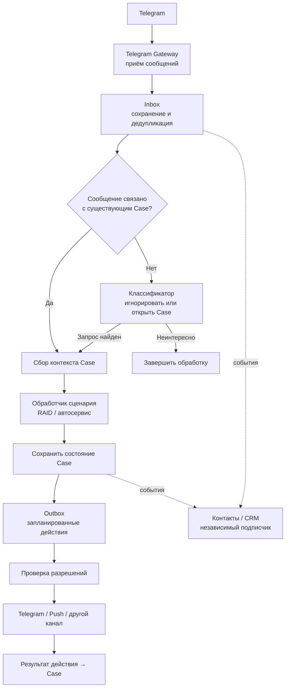
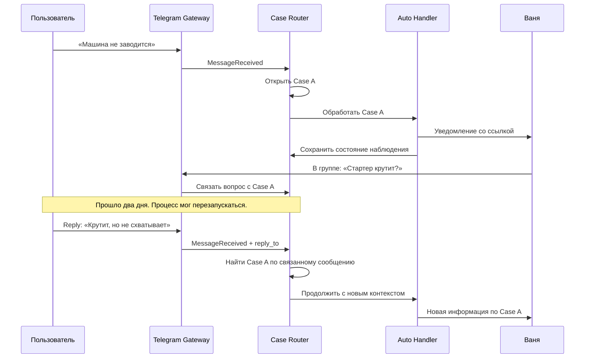

# Архитектура Aenea и границы компонентов

Статус: согласованная концепция от 23 ноября 2026 года с уточнением маршрутизации от 24 ноября. Реализованы [Telegram Reader и SQLite Inbox](telegram-reader.md), а также [registry, Router и dummy RaidSL](agent-routing.md). Полноценные Case и Outbox ещё не реализованы. Обе исходные диаграммы сохранены из обсуждения без изменений.

Aenea превращает сообщения из явно выбранных источников в запросы, которые можно обработать сразу или продолжить через несколько дней. Центральная сущность — `Case`, отдельный запрос со своим состоянием и историей. RAID и поиск клиентов автосервиса — разные сценарии одного механизма.

## Решения для первого MVP

- Один процесс с отдельными модулями; логические границы не требуют микросервисов.
- SQLite хранит сообщения, кейсы, задания, действия и состояние доставки. Ожидание ответа должно переживать перезапуск процесса.
- Telethon работает как пользовательский клиент отдельного Telegram-аккаунта. Реализованы команды подключения; live-вход проверяется отдельно пользователем.
- Начальный режим — чтение разрешённых групп и dry-run действий. Автоматические ответы включаются отдельно для конкретного сценария и группы.
- Hosted Langfuse используется для наблюдаемости, когда будет добавлена интеграция. Его недоступность не должна останавливать обработку кейсов.
- Отдельный [RaidSL Runner](raidsl-runner.md) проверяет OpenAI/Packet на fixture-данных. Первый фильтр Reader остаётся без LLM; реальный каталог и таланты ещё не подключены.
- LangGraph, отдельный брокер сообщений и собственный Langfuse-сервер в первый MVP не входят.
- CRM подключается как независимый потребитель событий. Ключи и сессии не хранятся в доменных таблицах SQLite.

## Общий поток

Уточнение границ: **AgentHub → Router → Agent → Action → Writer**. AgentHub хранит
паспорта интересов агентов, Router выбирает получателя по этим паспортам, агент
владеет предметной логикой. HITL может оставаться внутри конкретного агента;
обязательная подсистема human-in-the-loop общего фреймворка пока не вводится.
Текущий Router работает по фразам без LLM и не вызывает всех агентов. В dummy-срезе
есть только локальный IgnoreWriter и сохраняемый терминальный результат; будущая
запись в Telegram остаётся отдельной возможностью с политикой исполнения.

Сначала проверяется связь сообщения с существующим кейсом, затем распознаётся новый запрос. Ответ «на холодную, уже второй день» может не содержать триггера, но продолжать ранее открытый кейс.

Диаграмма показывает логический поток, а не отдельные сервисы или транзакции. Обработку продолжают только после успешной записи входного сообщения. Изменение состояния кейса и запись порождённых действий и событий должны фиксироваться атомарно в SQLite.

## Сущности

| Сущность | Ответственность и границы |
| --- | --- |
| `Message` | Нормализованное сообщение: источник, группа, автор, текст, время публикации и получения, reply и topic. Обновления учитываются как изменения сообщения; удаление не считается новым запросом. |
| `Signal` | Результат распознавания: тип намерения, извлечённые поля, сообщение-основание и версия правил. Может быть значением или событием без собственной таблицы. |
| `Case` | Один конкретный запрос: сценарий, участники, связанные сообщения, факты, состояние и ожидаемое продолжение. Один человек может иметь несколько открытых кейсов. |
| `Action` | Сохраняемое задание с ограниченной целью, параметрами, состоянием выполнения и результатом. Например, подготовить изображение, отправить reply или уведомить владельца. |
| `Identity` | Идентичность автора во внешней системе. Для обычного пользователя Telegram основа — user ID; имя и username являются изменяемыми атрибутами. Анонимного автора нельзя выдуманно превратить в известного человека. |
| `Contact` | Внутренняя карточка человека с внешними идентичностями и подтверждёнными контактами. Ответственность будущей CRM. |

Telegram topic, доменный `Case`, идентификатор исполнения LangGraph и LLM conversation — разные понятия. Telegram topic может содержать множество кейсов. Внутренний `case_id` не зависит от внешнего провайдера модели или наблюдаемости.

## Границы компонентов

| Компонент | Делает | Не делает |
| --- | --- | --- |
| Telegram Gateway | Принимает и нормализует сообщения и изменения; получает конкретное сообщение или ограниченный фрагмент истории; выполняет разрешённые команды отправки; возвращает внешний message ID. | Не знает персонажей RAID, признаков неисправности и правил CRM. |
| Inbox | Сохраняет входные события, различает повторы и изменения, обеспечивает возобновляемую обработку. | Не решает, что ответить пользователю. |
| Case Router | Находит связанный кейс; при отсутствии связи вызывает классификацию нового запроса; выбирает обработчик по сценарию. | Не использует LLM как обязательный универсальный оркестратор. |
| Context Builder | Собирает сообщения кейса, reply-цепочку и ограниченный релевантный контекст с указанием происхождения данных. | Не выгружает всю историю группы для каждого сообщения. |
| Classifier | Возвращает намерение, извлечённые поля или отсутствие распознанного запроса. На старте работает по правилам. | Не отправляет сообщения, не меняет контакты, не загружает произвольную историю самостоятельно. |
| Обработчик сценария | Выполняет явный workflow, вызывает разрешённые tools, обновляет кейс и создаёт действия. | Не владеет Telegram-сессией и не отправляет сообщения в обход Outbox. |
| Tools | Выполняют одну ограниченную операцию с определёнными входом, выходом и ошибками. | Не выбирают произвольно другие инструменты и не управляют всем кейсом. |
| Outbox и проверка разрешений | Хранят действия, управляют попытками и проверяют разрешение перед внешним эффектом. | Не считают любое запланированное действие автоматически разрешённым. |
| CRM | Независимо строит карточки по событиям и хранит подтверждённые связи и результаты. | Не является обязательной зависимостью приёма сообщений и ведения кейсов. |

Это логические интерфейсы внутри приложения. Создавать отдельный пакет, процесс или сетевой API для каждой строки сейчас не требуется.

## Чтение и запись в Telegram

Reader и Writer могут использовать один клиент и одну сессию, но должны иметь разные интерфейсы и разрешения. Классификатор и инструменты предметной области не получают полномочия Writer.

Начальная политика запрещает отправку сообщений, медиа, реакции и автоматическое вступление в группы. Позже отправку можно разрешить для RAID в конкретной группе, сохранив для автомобильных групп режим наблюдения и уведомления владельца. Разрешение проверяется в момент исполнения действия, в том числе после ожидания или перезапуска.

Read-only означает ограничение действий приложения с контентом, а не отдельный Telegram permission scope. Нельзя превращать этот режим в ghost mode: обходить или подменять статусы прочтения, присутствия и другие базовые механизмы Telegram. Детали обработки протокольных статусов проверяются при реализации Gateway.

## Сценарий RAID

1. Сообщение «дайте таланты на Аллюру» создаёт сигнал `raid.talents_requested`.
2. Router открывает кейс или связывает сообщение с уже существующим запросом.
3. Обработчик определяет канонического персонажа и нужный вариант билда.
4. Tools получают проверенный материал о талантах и готовят изображение.
5. Обработчик создаёт действие reply на исходное сообщение.
6. В dry-run результат сохраняется для проверки. При отдельно разрешённой отправке Writer выполняет действие и сохраняет внешний message ID.

Предполагаемые tools: `resolve_character`, `get_masteries`, `render_image`. Это границы возможностей, а не уже реализованные функции или окончательные API.

Получение талантов с HellHades и генерация изображения персонажа — разные операции. Доступность и условия использования материалов HellHades проверяются до интеграции. Неоднозначное имя или несколько вариантов талантов требуют уточнения либо ручной проверки. Подмена отсутствующих данных выдуманным билдом недопустима.

## Автосервис и отложенный ответ

Первое действие при запросе о неисправности — уведомление владельцу со ссылкой. Автоматический опрос клиента не входит в начальный режим. Ручные вопросы Вани и ответы клиента должны связываться с кейсом, когда Gateway имеет к ним доступ и есть достаточное основание для связи.

Стрелки обработчик → Ваня на диаграмме обозначают доставку уведомления через общий Outbox и канал доставки, а не прямой сетевой вызов из обработчика.

При ожидании не удерживаются запрос к модели, живой LLM thread или спящая coroutine. SQLite хранит сообщения, факты, ожидаемое продолжение и при необходимости время следующего действия. Новое событие запускает короткую обработку с восстановленным контекстом. История модели, если она появится, остаётся производной от доменного состояния.

Кейсу достаточно небольшого явного набора состояний, например: открыт, ожидает продолжения, требует ручного разбора, закрыт. Состояния отдельных действий хранятся отдельно от состояния кейса. Точные enum, сроки ожидания и правила повторного открытия определяются при реализации, а не считаются согласованной схемой БД.

## Связывание сообщений

Приоритет связи:

1. Reply на сообщение, уже связанное с кейсом.
2. Продолжение известной reply-цепочки.
3. Тот же автор, группа/topic и содержательно подходящий открытый кейс — только кандидат на связь.
4. Несколько подходящих кейсов или недостаточно контекста — ручной разбор без автоматического объединения.

Совпадения автора и группы недостаточно: через два дня человек может обсуждать другую машину или продавать велосипед. Ответ может прийти от другого участника; явную reply-связь оценивают отдельно от личности автора. Для исходящих сообщений сохраняется связь внешнего message ID с кейсом и действием, чтобы ответы на них возвращались в нужный контекст, а собственные сообщения не открывали новые кейсы по кругу.

## SQLite и надёжность

SQLite — источник состояния MVP. Конкретные миграции и набор таблиц пока не определяются, но должны покрывать входящие сообщения и их обработку, кейсы и связи сообщений, действия, журнал доменных событий и позиции независимых подписчиков. Транспортные позиции восстановления сохраняются отдельно от факта классификации.

- Обработка событий допускает повторы; повторное получение не должно повторять уже выполненное доменное действие.
- Внешнее сообщение идентифицируется источником, группой и message ID. Изменение сообщения обрабатывается как отдельная ревизия, а не отбрасывается дедупликацией.
- Обновление кейса, создание действий и доменных событий фиксируются одной транзакцией.
- Сетевые запросы не удерживают транзакцию SQLite. Медленные операции выполняются как сохраняемые задания; после перезапуска незавершённая работа восстанавливается.
- Изменения одного кейса применяются последовательно или с проверкой версии состояния, чтобы параллельные сообщения не затирали друг друга.
- Для доставки сохраняются идентификатор действия, состояние попытки и внешний результат. Не обещается универсальное exactly-once для внешних сервисов.
- Если отправка могла пройти, но подтверждение потерялось, результат помечается как неопределённый. Перед повтором выполняется доступная сверка или ручной разбор; слепой retry недопустим.
- `FloodWait` соблюдается; восстановление истории ограничивается. Ошибки авторизации не запускают бесконечный цикл повторного входа.

Не требуется вводить Kafka, Redis или отдельный task broker, чтобы обеспечить эти свойства в одном процессе. Объём сохраняемого контента, сроки хранения, удаление и резервное копирование уточняются перед live-пилотом; копии SQLite не должны становиться бесконтрольным архивом групп.

## CRM как независимый подписчик

CRM получает события об авторах, открытии кейса, новых ответах и отмеченных результатах. У подписчика собственная позиция обработки и защита от повторов. Его отставание или недоступность не блокируют основной поток; восстановление выполняется по сохранённым событиям в пределах выбранного срока хранения.

Связь с `Contact` строится через `Identity`, а не имя или username. Телефон не предполагается доступным. Разные аккаунты не объединяются в одного человека автоматически по сходству имени.

Оценки вроде «воздухан» допустимы как ручные заметки с автором и основанием либо как проверяемые наблюдения: «дважды договорились, не приехал». Предположение модели не должно становиться подтверждённым фактом о человеке.

## Наблюдаемость и модели

Hosted Langfuse подключается к этапам обработки и будущим LLM-вызовам. `case_id` используется как `session_id` для объединения трасс, отдельная обработка события — как trace. Langfuse не является БД кейсов, очередью или механизмом их возобновления. Сбой экспорта телеметрии не должен ломать бизнес-обработку.

По умолчанию в hosted-телеметрию передаются технические идентификаторы, этапы, длительности и результаты без содержимого чужих сообщений и контактных данных. Секреты не отправляются никогда. Тексты, промпты и ответы модели допускаются только после отдельного решения об использовании данных и настройке маскирования; автоматическое логирование содержимого нельзя считать безопасным значением по умолчанию.

OpenAI остаётся предусмотренной интеграцией за узким интерфейсом классификации/извлечения. Выбор модели, версии SDK и prompts относится к будущей реализации. Готовность ключа не является разрешением передавать модели сообщения Telegram.

LangGraph можно пересмотреть при появлении сложных ветвлений, нескольких шагов согласования и необходимости сохранять состояние графа. Он не заменяет Router, связывание сообщений и доменный `Case`. Для описанных сценариев первый выбор — явные обработчики и состояния в SQLite.

## Ограничения платформ

Telegram поддерживает сторонние клиенты, но это не гарантирует отсутствие блокировок или разрешение любого использования доступного контента. Для аккаунта нужен собственный `api_id`; вход под отдельным аккаунтом и соблюдение лимитов не отменяют ToS.

Условия Telegram содержат отдельные ограничения на AI/ML-использование контента. Первый фильтр может работать по обычным правилам. Использование реальных сообщений с LLM требует отдельного решения с учётом условий платформы и необходимого согласия. Не включать такую обработку как следствие появления API-ключа.

## Первый проверяемый срез после документации

До live-доступа: синтетическое сообщение RAID → сигнал → кейс → подготовленный ответ в dry-run → позднее уточнение → продолжение того же кейса после перезапуска. Затем подключается отдельный аккаунт и одна разрешённая группа. Отправка ответа в чат — отдельный последующий шаг после проверки политики и условий использования материалов.

Реализация этих механизмов не входит в текущий коммит документации.

## Источники решений

- [Telethon upstream](https://codeberg.org/Lonami/Telethon).
- [Telegram API Terms](https://core.telegram.org/api/terms), в частности ограничения изменения базового поведения клиента и использования данных.
- [Telegram Content Licensing Terms](https://telegram.org/tos/content-licensing).
- [Langfuse Observability](https://langfuse.com/docs/observability/overview) и [Sessions](https://langfuse.com/docs/observability/features/sessions).
- [LangGraph Persistence](https://docs.langchain.com/oss/python/langgraph/persistence) и [Interrupts](https://docs.langchain.com/oss/python/langgraph/interrupts).
