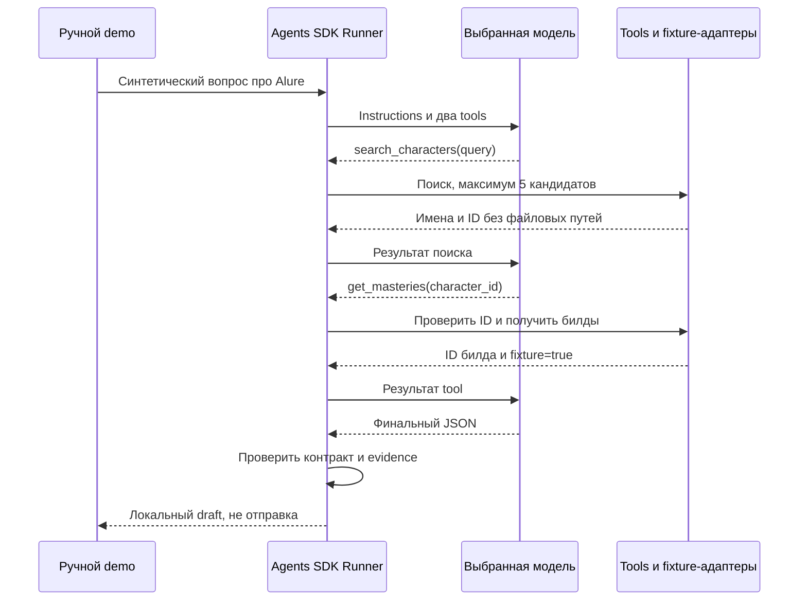

# RaidSL Runner и переключение провайдера

PR3 добавляет отдельный пакет `aenea-raidsl` с асинхронным Agents SDK Runner
и двумя read-only tools. Внешний каталог и алгоритм талантов ещё готовятся;
текущий срез проверяется на явно помеченных тестовых данных.

Это ручной demo, а не подключение LLM к Reader. `aenea-telegram watch --route`
по-прежнему использует dummy и сохраняет `ignore`. Модель вызывается только
отдельной командой `aenea-raidsl demo`.

## Компоненты

- `catalog.py`: внутренние интерфейсы `Catalog` и `MasteriesProvider`,
  in-memory каталог и загрузчик bundled fixture.
- `tools.py`: поиск, получение билдов и evidence текущего запуска.
- `agent.py`: instructions, два SDK tools, ограниченный Runner и проверка draft.
- `config.py`, `provider.py`: явный dev-профиль и фабрика клиента/модели.
- `dummy.py`: прежний dummy, перенесённый из `aenea_agents.raidsl`.
- `fixtures/`: два персонажа без aliases/переводов и SVG с надписью TEST FIXTURE.

Общий `aenea-agents` не зависит от SDK и игровой логики. Reader импортирует только
dummy: это не создаёт LLM-клиент. В `uv.lock` зафиксированы Agents SDK 0.26.0
и OpenAI Python SDK 3.59.0.

## Цикл обработки



`get_masteries` принимает только ID, возвращённый поиском этого запуска. Итог
`ready` принимается только для билда, фактически возвращённого tool. Модель
выбирает ID, но не URI изображения: `asset_ref` берётся из адаптера. Выдуманный
билд, лишний файловый путь или некорректный JSON отклоняются. Evidence создаётся
заново на каждый запуск и не переиспользуется между вопросами.

Другие статусы — `needs_clarification` и `not_found`, без artifact. Draft включает
текст, выбранные ID, `asset_ref`, признак fixture, провайдер, модель и usage.
Это ещё не Action отправки, не выполненный Writer и не сохраняемый Case.

## Будущий каталог

Формат внешнего JSON этим PR не фиксируется. Адаптер реализует асинхронные методы:

```text
Catalog.search(query, limit=5) → подходящие Character
Catalog.get(character_id) → Character
MasteriesProvider.get_masteries(character_id) → доступные MasteryBuild
```

Для внутреннего Character обязательны только стабильный `character_id` и `name`.
Переводы `names`, кортеж `aliases` и словарь `images` необязательны. Их отсутствие
допустимо; при добавлении переводы и aliases участвуют в поиске. Все 1000+
персонажей в prompt не передаются: модель видит только ограниченную выдачу tool.

Ссылки `file://` можно хранить во внешнем каталоге, но они не открываются моделью.
Каталог и изображения должны быть доступны машине Runner. Разрешение путей,
допустимый корневой каталог, обновление и кеширование определит файловый адаптер.
Он также должен выносить длительное чтение/парсинг из event loop или предварительно
загружать данные. Загрузчик fixture не является парсером будущего внешнего JSON.

Реальный get_masteries пока отсутствует. Fixture отдаёт один демонстрационный
билд для Alure и ничего для Kael; изображение содержит предупреждение TEST FIXTURE.
Это тест вызовов tools, а не игровые рекомендации. Реальный алгоритм подключается
адаптером после его описания владельцем проекта.

## Запуск

```sh
uv sync --locked --all-packages
uv run --locked --package aenea-raidsl aenea-raidsl --help

pass-cli run --env-file configs/raidsl/dev.openai.env.example -- \
  uv run --locked --package aenea-raidsl aenea-raidsl demo

pass-cli run --env-file configs/raidsl/dev.packet.env.example -- \
  uv run --locked --package aenea-raidsl aenea-raidsl demo
```

Demo обращается к выбранному провайдеру и может расходовать баланс. В запросы
попадают фиксированный синтетический вопрос и fixture-результаты. Telegram Inbox,
изображения и содержимое локальных файлов не загружаются модели.

| Настройка | OpenAI | Packet |
| --- | --- | --- |
| `AENEA_ENV` | `dev` | `dev` |
| `RAIDSL_PROVIDER` | `openai` | `packet` |
| `RAIDSL_BASE_URL` | `https://api.openai.com/v1` | `https://api.packet.ai/v1` |
| Протокол | Responses | Chat Completions |
| Модель примера | `gpt-5-nano` | `nvidia-deepseek-v4-1-flash-nvfp4` |
| `RAIDSL_API_KEY` | `pass://aenea/openai/api_key` | `pass://aenea/deepseek/api_key` |

Модель и провайдер выбираются явно; fallback между ними нет. Встроенная фабрика
принимает только endpoint выбранного провайдера. Ключ и organization/project
другой OpenAI-интеграции из shell не определяют эти вызовы. Packet обслуживает
модель DeepSeek, но не является прямым API DeepSeek.

Reference-профили можно скопировать в `.env.raidsl-openai`/`.env.raidsl-packet`.
В них остаются только ссылки и несекретные настройки. Их разрешает native
`pass-cli run`; SDK не разыменовывает pass://, собственного загрузчика нет.

## Ограничения

- Профили ограничивают Runner пятью шагами, ответ модели — 2048 выходными токенами
  на запрос, весь запуск — 60 секундами. Значения настраиваются в пределах приложения.
- Provider-managed HTTP retries выключены. При ошибке не выбирается другой провайдер.
- Итоговый JSON проверяется локально без обязательного vendor-specific strict
  output. Каждая новая комбинация модели и провайдера требует своего smoke-теста.
- SDK trace-export выключен, raw-ошибки и конфигурация с ключом не выводятся.
  CLI подавляет SDK/HTTP diagnostics. При встраивании library Runner вызывающий
  код также должен контролировать собственные logging handlers.
- Hosted Langfuse этим PR не подключается; безопасная телеметрия — отдельный шаг.
- Нет фонового worker, постоянной модельной сессии, Case/Outbox и Telegram Writer.
  Перед live-обработкой сообщений нужны сохраняемые задания и выполнение вне
  Reader callback, а также решение об использовании Telegram-контента.

## Проверки

Offline-тесты запускают настоящий SDK loop с fake Model и mock HTTP обоих
протоколов. Проверяются tools, пределы, отмена, изоляция evidence и отбрасывание
неподтверждённых результатов. Внешние аккаунты для этих тестов не нужны.

Live smoke 26 ноября 2026 года: OpenAI gpt-5-nano и Packet
nvidia-deepseek-v4-1-flash-nvfp4 завершили тот же demo с `ready`, `fixture=true`
и тремя model requests. Это техническая совместимость на одном примере,
а не оценка качества игровой логики или окончательный выбор модели.

Источники: [Models SDK](https://openai.github.io/openai-agents-python/models/),
[Tools SDK](https://openai.github.io/openai-agents-python/tools/),
[Packet Models](https://dash.packet.ai/docs/token-factory-models).
