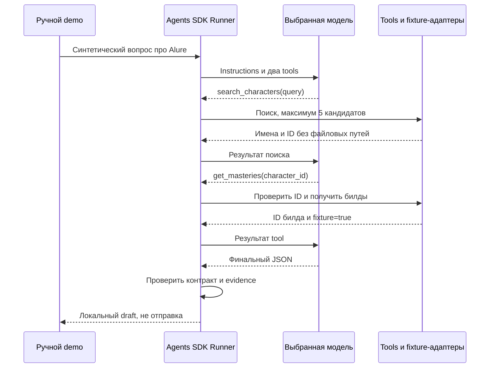

# RaidSL Runner и переключение провайдера

PR3 добавляет отдельный пакет `aenea-raidsl` с асинхронным Agents SDK Runner
и read-only tools. Доступны bundled fixture и внешний каталог через CLI v1.

Это ручной demo, а не подключение LLM к Reader. `aenea-telegram watch --route`
по-прежнему использует dummy и сохраняет `ignore`. Модель вызывается только
отдельной командой `aenea-raidsl demo` или `ask`.

## Компоненты

- `catalog.py`: внутренние интерфейсы `Catalog` и `MasteriesProvider`,
  in-memory каталог и загрузчик bundled fixture.
- `tools.py`: поиск, получение билдов и evidence текущего запуска.
- `runtime_tools.py`: фабрика набора tools и evidence на каждый запуск.
- `catalog_cli.py`: загрузка внешней фабрики, JSON Schema v1 и проверка рекомендаций.
- `agent.py`: instructions, ограниченный Runner и проверка draft.
- `config.py`, `provider.py`: явный dev-профиль и фабрика клиента/модели.
- `dummy.py`: прежний dummy, перенесённый из `aenea_agents.raidsl`.
- `fixtures/`: два персонажа без aliases/переводов и SVG с надписью TEST FIXTURE.

Общий `aenea-agents` не зависит от SDK и игровой логики. Reader импортирует только
dummy: это не создаёт LLM-клиент. В `uv.lock` зафиксированы Agents SDK 0.26.0
и OpenAI Python SDK 3.59.0.

## Цикл обработки



Диаграмма показывает fixture-цикл. В CLI backend доступен также `get_character`,
а `get_masteries` возвращает структурированные рекомендации. Fixture принимает
только ID из поиска текущего запуска; CLI поддерживает также точный selector. Итог
`ready` принимается только для билда, фактически возвращённого tool. Модель
выбирает ID, но не URI изображения: `asset_ref` берётся из адаптера. Выдуманный
билд, лишний файловый путь или некорректный JSON отклоняются. Evidence создаётся
заново на каждый запуск и не переиспользуется между вопросами.

Другие статусы — `needs_clarification` и `not_found`, без artifact. Draft включает
текст, выбранные ID, `asset_ref`, признак fixture, провайдер, модель и usage.
Это ещё не Action отправки, не выполненный Writer и не сохраняемый Case.

## Каталог через CLI v1

Реальный backend подключает внешнюю фабрику `create_catalog_tools(...)`:
**Agents SDK → function tool → CLI subprocess → JSON**. Aenea не читает внутренние
файлы импортера и не копирует его алгоритм. Фабрика загружается как доверенный
локальный Python-модуль: задавать её путь может только оператор, не модель.

| Переменная | Значение |
| --- | --- |
| `RAIDSL_CATALOG_BACKEND` | `fixture` по умолчанию, `cli` для реального каталога |
| `RAIDSL_CATALOG_DIR` | Обязательный путь к каталогу для `cli` |
| `RAIDSL_CATALOG_CLI` | Обязательный путь к `raid-catalog` |
| `RAIDSL_CATALOG_TOOLS` | Путь к фабрике; по умолчанию `agent_sdk_tools.py` рядом с CLI |
| `RAIDSL_CATALOG_METADATA` | Необязательный явный metadata-файл |

Пути должны быть доступны машине Runner. Отсутствующий явно заданный файл —
ошибка; переключения на fixture при отказе CLI нет. При отсутствии явного metadata
сам CLI использует `<catalog>/metadata.json`, если он существует.

Фабрика предоставляет `get_character`, `search_characters` и `get_masteries`.
Точный поиск разрешает известное имя, alias или стабильный ID; переводы не
изобретаются. Поиск ограничен пятью кандидатами за вызов, доступна пагинация.
Все 1000+ персонажей в prompt не загружаются. Пути и argv задаёт фабрика,
модель выбирает только предметные аргументы. Она сохраняет structured errors
даже при ненулевом exit code, ограничивает subprocess 15 секундами и завершает
его при отмене. Общий таймаут Runner действует поверх этого.

Копия публичной JSON Schema v1 закреплена в пакете как
`schemas/catalog-v1.schema.json`. Проверяется envelope, версия, форма результата
каждой операции и ссылки билдов на определения талантов. Business errors, включая
неоднозначное имя и отсутствие импорта, возвращаются модели как JSON; нарушение
протокола прерывает запуск. Несовместимая версия требует обновления адаптера.

`get_masteries` отдаёт готовые структурированные рекомендации. В evidence попадают
только `builds` с `validation=validated`; `unvalidated_builds` не допускаются в
выбор. Draft сохраняет выбранный билд, определения его талантов, источник,
предупреждения и количество отклонённых исходных наборов. `validated` означает
проверку структуры, а не гарантию оптимальной игровой тактики. При нескольких
различающихся ролях/режимах instructions требуют уточнения запроса.

**Готовой картинки талантов API не возвращает.** Для реального каталога
`asset_ref=null`, `fixture=false`; портрет героя не подставляется вместо картинки
билда. Рендеринг — следующий отдельный шаг. `file://` остаётся локальной ссылкой:
модель получает JSON-метаданные с URI, но содержимое изображений не читается
и автоматически не отправляется провайдеру.

Fixture остаётся изолированным тестовым backend с двумя героями, одним
демонстрационным билдом Alure и SVG с надписью TEST FIXTURE.

## Запуск

```sh
uv sync --locked --all-packages
uv run --locked --package aenea-raidsl aenea-raidsl --help

pass-cli run --env-file configs/raidsl/dev.openai.env.example -- \
  uv run --locked --package aenea-raidsl aenea-raidsl demo

pass-cli run --env-file configs/raidsl/dev.packet.env.example -- \
  uv run --locked --package aenea-raidsl aenea-raidsl demo
```

Реальный каталог (пути заменить на свои, данные должны быть подготовлены):

```sh
export RAIDSL_CATALOG_BACKEND=cli
export RAIDSL_CATALOG_DIR=/absolute/catalogue
export RAIDSL_CATALOG_CLI=/absolute/repository/tool/champion-catalog/raid-catalog
pass-cli run --env-file configs/raidsl/dev.openai.env.example -- \
  uv run --locked --package aenea-raidsl aenea-raidsl ask \
  --question 'Дайте таланты на Ronda для PvE. Если ролей несколько, уточни.'
```

Внешний каталог запускается без credentials; они нужны только для модели.
В запрос к провайдеру уходят ручной вопрос и JSON-результаты tools, включая
описания талантов, source и локальные URI. Содержимое изображений не уходит.

Demo обращается к выбранному провайдеру и может расходовать баланс. В запросы
для fixture попадают синтетический вопрос и fixture-результаты. Telegram Inbox,
изображения и содержимое локальных файлов не загружаются модели.

| Настройка | OpenAI | Packet |
| --- | --- | --- |
| `AENEA_ENV` | `dev` | `dev` |
| `RAIDSL_PROVIDER` | `openai` | `packet` |
| `RAIDSL_BASE_URL` | `https://api.openai.com/v1` | `https://api.packet.ai/v1` |
| Протокол | Responses | Chat Completions |
| Модель примера | `gpt-5-nano` | `nvidia-deepseek-v4-1-flash-nvfp4` |
| `RAIDSL_API_KEY` | `pass://aenea/openai/api_key` | `pass://aenea/deepseek/api_key` |

Модель и провайдер выбираются явно; fallback между ними нет. Встроенная фабрика
принимает только endpoint выбранного провайдера. Ключ и organization/project
другой OpenAI-интеграции из shell не определяют эти вызовы. Packet обслуживает
модель DeepSeek, но не является прямым API DeepSeek.

Reference-профили можно скопировать в `.env.raidsl-openai`/`.env.raidsl-packet`.
В них остаются только ссылки и несекретные настройки. Их разрешает native
`pass-cli run`; SDK не разыменовывает pass://, собственного загрузчика нет.

## Ограничения

- Профили ограничивают Runner пятью шагами, ответ модели — 2048 выходными токенами
  на запрос, весь запуск — 60 секундами. Значения настраиваются в пределах приложения.
- Provider-managed HTTP retries выключены. При ошибке не выбирается другой провайдер.
- Итоговый JSON проверяется локально без обязательного vendor-specific strict
  output. Каждая новая комбинация модели и провайдера требует своего smoke-теста.
- SDK trace-export выключен, raw-ошибки и конфигурация с ключом не выводятся.
  CLI подавляет SDK/HTTP diagnostics. При встраивании library Runner вызывающий
  код также должен контролировать собственные logging handlers.
- Hosted Langfuse этим PR не подключается; безопасная телеметрия — отдельный шаг.
- Нет фонового worker, постоянной модельной сессии, Case/Outbox и Telegram Writer.
  Перед live-обработкой сообщений нужны сохраняемые задания и выполнение вне
  Reader callback, а также решение об использовании Telegram-контента.

## Проверки

Offline-тесты запускают настоящий SDK loop с fake Model и mock HTTP обоих
протоколов. Проверяются tools, пределы, отмена, изоляция evidence и отбрасывание
неподтверждённых результатов. Внешние аккаунты для этих тестов не нужны.

Live smoke 26 ноября 2026 года: OpenAI gpt-5-nano и Packet
nvidia-deepseek-v4-1-flash-nvfp4 завершили тот же demo с `ready`, `fixture=true`
и тремя model requests. Offline smoke реальной фабрики и subprocess CLI проверил Alure → `raid:1030`,
два валидированных PvE-билда Ronda и structured `CHARACTER_NOT_FOUND`.

Live smoke с реальным CLI через Packet: неопределённый запрос Ronda PvE дал
`needs_clarification` между Clan Boss и Nuker; явный выбор `pve-1` дал `ready`,
`raid:7360`, 15 определений талантов и `asset_ref=null`. Оба запуска потребовали
по два model requests.

Live smoke — техническая совместимость на нескольких примерах,
а не оценка качества игровой логики или окончательный выбор модели.

Источники: [Models SDK](https://openai.github.io/openai-agents-python/models/),
[Tools SDK](https://openai.github.io/openai-agents-python/tools/),
[Packet Models](https://dash.packet.ai/docs/token-factory-models).
