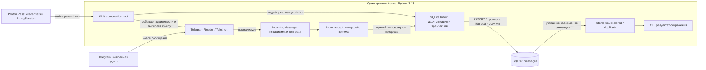
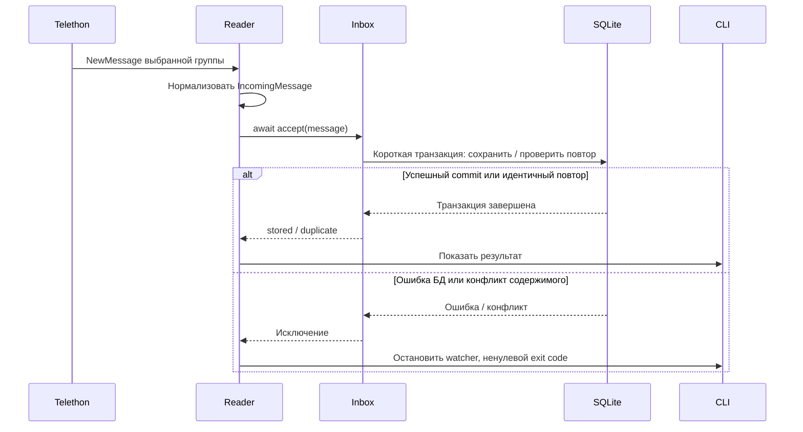
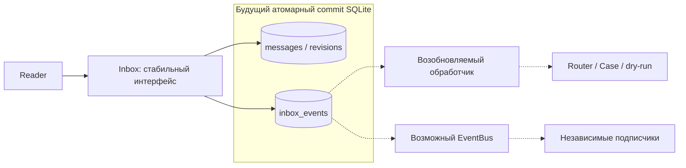

# Aenea: минимальный Inbox для Telegram POC

Статус: **предложение для review**, 24 ноября 2026 года. Это спецификация
следующего среза, а не описание уже реализованного хранения. Реализация Inbox
начинается после review. Основание — [архитектура Aenea](../../architecture.md).

## Цель и границы

Сохранять новые сообщения одной явно выбранной Telegram-группы в локальную
SQLite, отделив Telethon от хранения небольшим типизированным интерфейсом.
Повторная доставка одного сообщения не создаёт вторую запись. Успешный приём
означает завершённый commit, а не помещение данных в оперативную память.

**Пока без EventBus.** Это решение для текущего этапа, не запрет на будущую
шину событий. Сейчас также не нужны RabbitMQ, Kafka, Redis, IPC, отдельный
процесс worker или очередь `asyncio.Queue` перед сохранением.

## High-level архитектура текущего среза



Диаграмма показывает поток данных и логические границы, а не отдельные сервисы.
Стрелка `PORT → SQLITE` означает подстановку реализации интерфейса. Для повтора
результат возвращается после успешного завершения проверки в транзакции,
без добавления строки. Credentials и сессия не проходят через IncomingMessage
и не попадают в доменную SQLite.

### Ответственность компонентов

| Компонент | Делает | Не делает |
| --- | --- | --- |
| CLI / composition root | Проверяет параметры, создаёт Inbox и Reader, управляет запуском и завершением. | Не распознаёт запросы талантов и не решает судьбу кейсов. |
| Telegram Reader | Принимает события выбранной группы, нормализует сообщение, вызывает Inbox и ждёт результат. | Не знает SQL, сценарии RAID, обработчики или устройство будущего EventBus. |
| IncomingMessage | Передаёт нормализованные данные между транспортом и приложением. | Не содержит Telethon-объекты, ключи, сессии и произвольные RPC payload. |
| Inbox | Задаёт семантику приёма: сохранить либо распознать идентичный повтор. | Не классифицирует запрос и не рассылает события подписчикам. |
| SQLite Inbox | Выполняет дедупликацию и атомарную запись, возвращает результат после commit. | Не отправляет сообщения в Telegram и не вызывает LLM. |

## Контракт и идентичность сообщения

Концептуальная форма интерфейса — не окончательный API реализации:

```python
class Inbox(Protocol):
    async def accept(self, message: IncomingMessage) -> StoreResult: ...
```

`IncomingMessage` — неизменяемый dataclass. Минимальные поля:

| Поле | Семантика |
| --- | --- |
| `source` | Система-источник; в этом срезе `telegram`. |
| `source_account_id` | Стабильный Telegram ID аккаунта Reader; не телефон и не ID сессии. |
| `chat_id` | Стабильный ID группы в принятом нормализованном формате Telegram. |
| `message_id` | Внешний ID сообщения внутри области `source + source_account_id + chat_id`. |
| `sender_id` | Внешний идентификатор отправителя, если известен; не гарантированно человек. |
| `text` | Текст или подпись; пустая строка допустима, медиа не скачиваются. |
| `sent_at` | Время публикации сообщения в UTC. |
| `received_at` | Время получения приложением в UTC. |
| `reply_to_message_id` | ID обычного сообщения, на которое отвечают **в текущей группе**; иначе `null`. |
| `reply_to_peer_id` | Явно переданный Telegram peer назначения reply, нормализованный в marked ID; `null`, если поле отсутствует. |
| `topic_id` | ID Telegram topic, если доступен. Это не ID доменного Case. |
| `metadata_version` | Версия нормализованной JSON-проекции метаданных. |
| `metadata_json` | Богатый снимок доступных полей самого сообщения и вложенных заголовков; правила ниже. |

Ключ наблюдаемого сообщения: **`(source, source_account_id, chat_id, message_id)`**.
`sender_id`, текст и тип содержимого не входят в идентичность. В обычных группах
Telegram ID сообщения принадлежит последовательности принимающего аккаунта;
в супергруппах и каналах — последовательности самого канала. Поэтому прежнее
предложение `(source, chat_id, message_id)` достаточно только при неизменном
единственном аккаунте. Сессии одного аккаунта используют одинаковые ID:
перелогин не меняет `source_account_id`.
[Описание Telegram updates и последовательностей ID](https://core.telegram.org/api/updates).

Это уточнение пространства источника относительно общей `architecture.md`.
Сейчас работает один аккаунт Reader, но случайная смена аккаунта не должна
вызывать ложную дедупликацию. Межаккаунтное объединение наблюдений не выполняется;
для супергрупп его можно спроектировать отдельно. Личные диалоги и иные источники
этот контракт автоматически не разрешает.

Неизвестный или анонимный автор не преобразуется в выдуманного пользователя.
Имена и username не используются как стабильный ключ человека.

`StoreResult` содержит ключ сообщения и результат `stored` либо `duplicate`.
Сбой записи и конфликт содержимого — ошибки, а не третий вариант успеха.

### Reply: сохраняем контекст, связываем только внутри группы

Область контракта для автоматической связи — **текущая группа и текущий аккаунт
Reader**. Заголовок Telegram `MessageReplyHeader` сохраняется как данные, но
не является разрешением читать другой чат или объединять кейсы.
[Поля MessageReplyHeader](https://core.telegram.org/constructor/messageReplyHeader).

Правила нормализации:

1. `reply_to_peer_id` отсутствует: обычный `reply_to_msg_id` относится к текущей
   группе и попадает в `reply_to_message_id`.
2. Явный peer после нормализации совпадает с `chat_id`: применяется то же правило.
3. Явный peer другой или не может быть однозначно нормализован:
   `reply_to_message_id = null`. Исходный ID сообщения, тип/ID peer и прочие
   поля reply сохраняются в `metadata_json.reply_to`; Router не получает
   ложную локальную ссылку.
4. Ссылки на scheduled/ephemeral сообщения сохраняются в метаданных, но не
   преобразуются в обычную локальную ссылку: их пространство ID не смешивается
   с текущим Inbox.

Для Telegram peers сохраняются и тип (`user`, `chat`, `channel`), и исходный ID;
сравнение чатов выполняется по единому marked ID, как у `chat_id`. Голые числа
из разных типов peers не сравниваются как один идентификатор.

Будущий Router ищет только ключ
`(source, source_account_id, chat_id, reply_to_message_id)`. Если целевого
сообщения ещё нет в SQLite, ссылка остаётся неразрешённой. Она не превращается
в связь по совпавшему ID из другого чата/аккаунта. `topic_id` также не выводится
из заголовка внешнего reply как будто это topic текущей группы.

Для этих правил дополнительных запросов истории, получения чужого сообщения
или вступления в другой чат не требуется. Даже если другая группа тоже
разрешена для чтения, межгрупповая связь Case автоматически не включается.

### Богатый снимок сообщения для будущего анализа

Решение review: **сохранять максимум уже полученных данных самого сообщения**,
а не только текст. Базовые поля остаются отдельными колонками для ключей и SQL;
остальное хранится в версионированном `metadata_json` в той же строке. Это не
требует дополнительных таблиц и не включает LLM-обработку.

Состав проекции для поддерживаемой версии Telethon фиксируется явно:

| Группа данных | Что сохраняется, если уже есть в полученном сообщении |
| --- | --- |
| Тип и происхождение | Тип Telegram-конструктора, ID/типы отправителя и назначения, `post_author`, `via_bot_id`, исходящие/post/service флаги, дата редактирования, ID альбома `grouped_id`. |
| Текст | Полный текст/подпись и entities: типы, offsets, lengths, URL и дополнительные идентификаторы entities. Offsets Telegram сохраняются в исходных единицах UTF-16. |
| Reply и topic | Полный нормализованный заголовок reply: исходный message ID, peer, top ID, forum/scheduled/quote флаги, цитата и её entities/offset, доступные сведения об исходном авторе/медиа. Неподдерживаемые для связывания варианты всё равно остаются данными. |
| Пересылка | Доступные поля заголовка forward: источник/автор, исходные IDs, дата, подпись. Это provenance, а не подтверждение личности или разрешение обходить другие чаты. |
| Медиа | Тип и устойчивые идентификаторы медиа, MIME, имя, размер, длительность, размеры изображения/видео, атрибуты аудио/стикера/документа, spoiler-флаги. Без скачивания файлов и thumbnail bytes. |
| Структурированный контент | Уже вложенные данные опросов, геопозиций, контактов, web preview и service action — по явной схеме для поддерживаемых конструкторов. Никаких дополнительных запросов профилей или адресной книги. |
| Снимок состояния | Доступные счётчики просмотров/пересылок/ответов, агрегаты реакций, результаты опроса и прочие наблюдаемые флаги на момент приёма. Это снимок, а не полная история изменений. |

Данные контакта или геопозиции здесь означают содержимое, уже опубликованное
в сообщении выбранной группы. Они не запускают импорт контактов, геокодирование,
CRM-обогащение или запрос сведений об участниках. Такой SQLite-файл содержит
персональные данные; его нельзя автоматически экспортировать агентам/LLM,
в Langfuse, CI-артефакты или общие логи. Будущий агент получает только явно
разрешённую выборку, а текст сообщения рассматривается как недоверенные данные.

Не сохраняются credentials, StringSession, auth keys, `access_hash`,
`file_reference`, байты файлов/миниатюр и вспомогательные кеши User/Chat.
Служебные ключи доступа не нужны для анализа и не должны становиться частью
аналитической БД. `metadata_json` — нормализованная проекция одного сообщения,
а не безусловный `event.to_dict()` со всем окружением транспорта. Сериализация
рекурсивно проходит только разрешённые поля поддерживаемых конструкторов;
после обновления SDK новые поля не принимаются автоматически.

Для неизвестного типа вложения сохраняется его имя конструктора и признак
неполной проекции, а базовое сообщение не теряется. Проекция не должна молча
обрезать длинный текст или JSON; ошибка записи/сериализации явно останавливает
приём. Изменение состава проекции требует новой `metadata_version` и проверки
совместимости при повторной подаче старых данных.

Это расширяет объём **первого снимка**, но не подписывает Reader на edits,
реакции и изменения счётчиков. История таких обновлений — отдельный срез.

## SQLite: минимальное хранение

В текущем срезе создаётся **одна таблица `messages`** с полями контракта и
уникальным ограничением `(source, source_account_id, chat_id, message_id)`. Отдельная таблица
событий, статус обработки, курсоры подписчиков и очередь заданий сейчас не нужны:
потребителей ещё нет. Версия схемы фиксируется через SQLite `user_version`;
несовместимая версия блокирует открытие, файл молча не пересоздаётся.

Правила приёма:

1. Новый ключ — записать сообщение и выполнить commit; вернуть `stored`.
2. Известный ключ и идентичные содержательные поля — вернуть `duplicate`.
   Новое `received_at` само по себе не создаёт конфликт: сохраняется время
   первого успешного приёма и исходный снимок метаданных.
3. Известный ключ, но отличаются текст, отправитель, время публикации, reply или
   topic, entities, происхождение или устойчивое содержимое вложения — поднять
   явную ошибку конфликта; исходную запись не перезаписывать.
   Это может быть ревизия или несогласованная нормализация. В этом срезе
   автоматическая обработка конфликта не реализуется.

Сравнение выполняется по канонической проекции устойчивого содержимого, а не
по строке всего JSON. Порядок ключей JSON, `received_at`, значения наблюдаемых
счётчиков/реакций и иные поля снимка состояния не создают конфликт. При таком
повторе первый снимок не обновляется; сохранение всех наблюдений потребует
отдельной истории. Между несовместимыми `metadata_version` сравнение не
угадывается: требуется явная миграция/совместимая проекция, иначе приём
завершается ошибкой версии. Реализация должна фиксировать и тестировать состав
устойчивой проекции для каждого поддержанного вида содержимого.

Уникальность обеспечивает ограничение БД, а не только предварительный `SELECT`.
Проверка конфликта и запись выполняются в короткой транзакции; сетевые операции
в неё не входят. Записи внутри одного процесса сериализуются. Открытие одной БД
несколькими активными экземплярами watcher пока не является поддержанным режимом.

Для низкой нагрузки POC допустим короткий синхронный SQLite-вызов внутри
реализации async-интерфейса: блокировка БД должна иметь ограниченный таймаут,
а сетевые вызовы и медленные обработчики отсутствуют. Если измерения покажут
заметные задержки, выполнение SQL можно вынести в отдельный поток, сохранив
семантику `accept`; отдельный брокер для этого не требуется.

## Порядок выполнения и отказ



Telethon может перехватить исключение пользовательского callback и продолжить
работу. Поэтому ошибка Inbox должна явно передаваться управляющей coroutine:
та отключает Reader и завершает CLI с ошибкой. Просто бросить исключение внутри
callback недостаточно. Новые события после фатальной ошибки не принимаются;
это не обещание мгновенной отмены уже начатой записи.

Результат `stored` выводится только после успешного commit. Если процесс упал
после commit, но до вывода, строка уже сохранена; повторная подача того же
сообщения даст `duplicate`. Если запись не завершилась, успешного результата нет.
Ошибка вывода после commit не откатывает сохранённое сообщение.

При штатном `Ctrl+C` Reader прекращает приём и завершает уже начатую короткую
запись перед закрытием БД. Аварийное завершение, отказ диска и потеря питания
покрываются только реальными гарантиями выбранной конфигурации SQLite и ОС;
универсальная гарантия exactly-once не заявляется.

## Сохранение и доставка — разные гарантии

Этот срез сохраняет сообщения, **которые приложение успело получить и принять**.
Он не восстанавливает сообщения, пропущенные при отключении, перезапуске или
фатальной ошибке до commit. Текущая StringSession хранит авторизацию, а не
надёжную позицию обработки источника.

Дочитывание истории и сохранение транспортных позиций — отдельный следующий
дизайн. Пока он не реализован, после остановки нельзя обещать отсутствие
пропусков. Редактирования и удаления также потребуют отдельного представления
ревизий/событий; они не считаются новыми сообщениями и сейчас не подписываются.

## Как появятся обработчики и EventBus



Это **путь расширения, а не объём текущей реализации**. Когда появится первый
обработчик, сохранение сообщения и задания на его обработку должно стать
атомарным. Понадобятся durable `inbox_events` и сохраняемое подтверждение
обработки, чтобы продолжать после падения. Обработчик можно сначала запускать
в том же процессе; Consumer не получает Telethon-клиент или его credentials.

EventBus имеет смысл пересмотреть при нескольких независимых потребителях,
разных политиках повторов или требованиях к независимому исполнению. Даже тогда
уведомление в памяти может лишь ускорять пробуждение: сохранённые события и
позиции обработки остаются источником восстановления. Шина событий сама по
себе не заменяет commit, дедупликацию и состояние потребителя.

## Структура monorepo и запуск

- `packages/contracts` — `IncomingMessage`, ключ и результат приёма, без Telethon
  и SQLite. Интерфейс Inbox и его реализация могут оставаться в приложении:
  отдельный пакет для каждого слоя не нужен.
- `apps/telegram-agent` — CLI, адаптер Telethon, Inbox Protocol и SQLite Inbox.
  CLI связывает зависимости. Тест подставляет fake Inbox без Telegram.
- Путь БД задаётся явно параметром/конфигурацией dev, например
  `runtime/aenea.dev.sqlite3`. БД исключена из Git. Она содержит текст сообщений,
  поэтому не публикуется вместе с логами, артефактами CI или Langfuse.
- Автоматически очищать, архивировать или копировать историю не добавляем.
  Используем тестовую группу; сроки хранения и управление доступом для реальных
  групп согласуются до расширения пилота.

Язык POC — Python 3.13 с uv. **Windows пока не поддерживается текущим login**:
реализация скрытого ввода использует Unix `termios` и `/dev/tty`; импорт
Unix-модуля также мешает нативному запуску CLI на Windows. Это ограничение
адаптера входа, не требование Inbox. Контракты, SQLite и будущие обработчики
не должны зависеть от Unix API. WSL или отдельный Windows-адаптер ввода можно
рассмотреть позже; их работоспособность этой спецификацией не подтверждается.

## Проверяемый результат

1. Сообщение выбранной группы появляется в SQLite; после перезапуска остаётся.
2. Повторная подача того же нормализованного сообщения оставляет одну строку,
   возвращает `duplicate` и не заменяет исходное `received_at`.
3. Одинаковый `message_id` в разных группах или у разных аккаунтов Reader
   даёт независимые строки; новая сессия того же аккаунта не меняет ключ.
4. Отличающийся текст под тем же ключом вызывает конфликт без потери исходной
   записи. Изменение отправителя/topic/reply проверяется аналогично.
5. Reply/topic сохраняются; неизвестный автор и пустой текст допустимы.
   Внешний reply сохраняет исходные peer/message IDs в metadata, но не создаёт
   локальный `reply_to_message_id`. Отсутствующий peer и peer текущей группы
   дают локальную ссылку; одинаковый ID в чужом чате не разрешается как цель.
6. Ошибка записи или конфликт доходят до управляющей coroutine, watcher
   прекращает работу и завершается с ненулевым кодом, а не продолжает молча.
7. Вывод `stored` не предшествует commit; повторная подача после сбоя вывода
   не создаёт дубликат. Штатная остановка не бросает начатую запись.
8. Личные диалоги и сообщения других групп не передаются в Inbox. Credentials,
   StringSession и код/пароль входа отсутствуют в таблице и логах.
9. Богатые метаданные, Unicode/entities и медиа-атрибуты сохраняются после
   перезапуска; допустимый неизвестный конструктор отмечается без потери текста.
   `access_hash`, `file_reference` и прочие исключённые поля удалены также из
   вложенных reply/forward/media, файлы и профили дополнительно не загружаются.
10. Повтор с другим порядком JSON-ключей, изменившимися счётчиками или реакциями
    остаётся `duplicate` и не перезаписывает первый снимок; изменение устойчивого
    содержимого и несовместимая версия проекции явно отклоняются.

Контракты, транзакции, дедупликация и ошибки проверяются offline с временной
SQLite и fake транспортом. Live smoke — явно выбранная тестовая группа,
отправка сообщения вручную из официального Telegram и проверка записи после
перезапуска. Механизмы Case, классификации и dry-run не входят в этот срез.

## Что требуется от review

- Подходит ли прямой `await Inbox.accept` как граница до появления EventBus?
- Достаточно ли одной таблицы до первого потребителя событий?
- Приемлема ли остановка на конфликте/ошибке вместо молчаливого продолжения?
- Подтверждаем ли live-only приём без восстановления пропусков на этом шаге?

Детальная реализация и изменения кода хранения в этот документ не входят.
